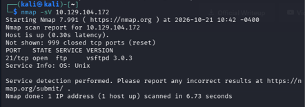
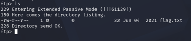

# Fawn

**Difficulty:** Very Easy

## 1. Setup

To connect to the target machine, I used OpenVPN with the configuration file provided by Hack The Box (HTB). Alternatively, you can use Pwnbox to access the lab environment without setting up a VPN on your own computer.


After downloading the Starting Point VPN configuration file, I opened the terminal and ran the following command to connect to the VPN.

```bash
sudo openvpn <path-to-file>
```


To get the target's IP address, I pressed the **Start Machine** button on the HTB website.


After waiting for a while, the target machine's IP address appeared on the page. Keep in mind that the IP address may change each time you start the machine, so make sure to use the IP address currently displayed on the HTB website.


After connecting to the VPN, I used the `ping` command with the target's IP address to check whether the machine was reachable.

```bash
ping <TARGET_IP>
```


If the target responds to ping requests, it indicates that the machine is reachable over the network. You can stop the command by pressing `Ctrl + C`. However, some machines block ping requests, so receiving no response does not necessarily mean the machine is offline.

Now that the connection was set up, I was ready to start investigating the target machine.

## 2. Tools Used

- **Nmap:** Nmap scans a target machine by sending network packets to its ports and analyzing the responses. These responses help determine which ports are open, closed, or filtered by a firewall. Nmap can also identify the services running on open ports. When using the `-sV` option, Nmap sends additional probes to identify services and their versions, if possible. This information helps us understand what the target machine is running and decide which services need further investigation. Knowing the service version can also help us identify potential vulnerabilities.

- **FTP (File Transfer Protocol):** FTP uses TCP to communicate between a client and a server. It commonly uses port 21 for the control connection, which carries commands such as listing directories and requesting files. During file transfers, FTP uses a separate data connection to transfer file contents or directory listings. How this data connection is established depends on whether FTP is operating in active or passive mode. When a data transfer finishes, the data connection is typically closed, while the control connection remains open for additional commands until the user disconnects.

## 3. Commands Used

| Command | Purpose |
|---|---|
| `nmap -sV <TARGET_IP>` | Scan the target machine and identify its running services and versions. |
| `ftp <TARGET_IP>` | Connect to the target machine's FTP service. |
| `ls` | List files and directories in the current directory. |
| `cat <FILE>` | Display the contents of a file in the local terminal. |
| `pwd` | Display the current working directory. |
| `get <FILE>` | Download a file from the FTP server to the local working directory. |
| `bye` | Close the FTP session and disconnect from the server. |

## 4. Enumeration

### Scanning the Target

After confirming that the target machine was reachable, I used Nmap to investigate which services were running on the machine.

```bash
nmap -sV <TARGET_IP>
```



From the scan results, I found that the target was running an FTP service on port 21.

FTP is a network protocol used to transfer files between a client and a server. However, standard FTP does not encrypt its communication by default, which means that credentials and transferred data may be vulnerable to interception.

Modern alternatives include SFTP, which transfers files over SSH and provides encrypted communication. SFTP is a separate protocol rather than a newer version of FTP.

Since the target was running an FTP service, I decided to connect to it and investigate whether I could access any files.

### Connecting to the FTP Service

I used the following command to connect to the target's FTP service.

```bash
ftp <TARGET_IP>
```


After connecting, the server returned the response code `220`, which indicates that the FTP service is ready to receive commands.

The server then requested a username. I decided to try `anonymous` to check whether the server allowed anonymous FTP access.


After entering `anonymous` as the username, the server requested a password. I pressed Enter to try logging in without providing a password.


The login was successful, and the server returned response code `230`, indicating that the user had logged in successfully.

This showed that the FTP server allowed anonymous access without requiring a password in this case.

### Listing Files on the Server

After logging in, I used the `ls` command to list the files and directories available through the FTP service.

```text
ls
```


The listing revealed the flag file I was looking for.

However, I could not use the local `cat` command directly through the FTP client to read the file. I needed to download it to my own computer first.

### Downloading the Flag

I used the `get` command to download the flag file from the FTP server.

```text
get <FLAG_FILE>
```

Replace `<FLAG_FILE>` with the actual filename shown in the FTP directory listing.


After downloading the file, I used `bye` to exit the FTP session.

```text
bye
```

The server returned response code `221`, indicating that the FTP session was being closed.

### Reading the Downloaded File

After disconnecting from the FTP server, I checked my current working directory using `pwd`.

```bash
pwd
```


The output showed the path of my current directory. I then used `ls` to check whether the downloaded file was present.

```bash
ls
```



The file appeared in the directory, so I used `cat` to display its contents.

```bash
cat <FLAG_FILE>
```


The command displayed the flag, confirming that I had successfully retrieved the file from the target machine.

## 5. Findings

During this challenge, I discovered that the target machine was running an FTP service on port 21. After connecting to the service, I found that anonymous login was permitted without a password.

This allowed me to list the available files, locate the flag, and download it to my local machine. I then used `cat` to read the downloaded file and retrieve the flag.

The main security issue I identified was that the FTP service allowed anonymous access to files that were accessible through the account. Whether this represents a vulnerability depends on the intended access policy and which files the account is permitted to access.

## 6. Lessons Learned

Through this challenge, I learned how to use Nmap to identify running services and how to interact with an FTP server to investigate its accessible files.

I also learned the basic FTP workflow: connecting to a server, authenticating, listing files, downloading a file, and disconnecting from the session.

Another important lesson was that anonymous FTP access can expose files if the server is not configured with appropriate access restrictions. In addition, standard FTP does not encrypt its communication by default, making secure alternatives such as SFTP preferable when confidentiality is required.

In future investigations, I would examine the permissions and accessible files of any discovered service to understand what information might be exposed.

## 6. Lessons Learned

Summarize the technical concepts you learned and what you would investigate differently next time.
