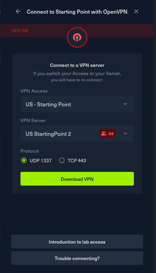
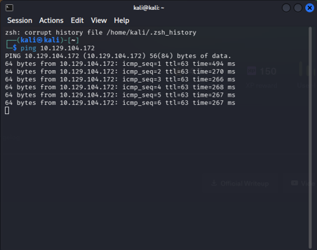

# Fawn

**Difficulty:** Very Easy
## 1. Setup

To connect to the target machine, I used OpenVPN with the configuration file provided by Hack The Box (HTB). Alternatively, you can use Pwnbox to access the lab environment without setting up a VPN on your own computer.



After downloading the Starting Point VPN configuration file, I opened the terminal and ran the following command to connect to the VPN.

```bash
sudo openvpn <path-to-file>
```


To get the target's IP address, I pressed the **Start Machine** button on the HTB website.


After waiting for a while, the target machine's IP address appeared on the page. Keep in mind that the IP address may change each time you start a machine, so make sure to use the IP address currently displayed on the HTB website..



After connecting to the VPN, I used the `ping` command with the target's IP address to check whether the machine was reachable.

```bash
ping <TARGET_IP>
```


If the target responds to the ping requests, it indicates that the machine is reachable over the network. You can stop the command by pressing `Ctrl + C`. However, some machines block ping requests, so no response does not always mean the machine is offline.

Now that the connection was set up, I was ready to start investigating the target machine.

## 2. Tools Used

- **Nmap:** To scan the target and identify open ports and services.
- **Telnet:** To investigate the Telnet service running on the target.

## 3. Commands Used

| Command                | Purpose                                              |
| ---------------------- | ---------------------------------------------------- |
| `nmap -sV <TARGET_IP>` | Scan the target and identify running services.       |
| `telnet <TARGET_IP>`   | Attempt to connect to the Telnet service.            |
| `ls`                   | List files and directories in the current directory. |
| `cat <FILE>`           | Display the contents of a file.                      |

## 4. Enumeration

Document the scan results, the services you identified, and why you decided to investigate them.

## 5. Findings

Explain what you discovered during the challenge and how you reached your conclusions.

## 6. Lessons Learned

Summarize the technical concepts you learned and what you would investigate differently next time.
