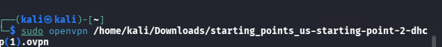
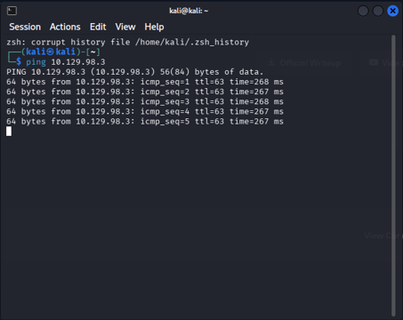
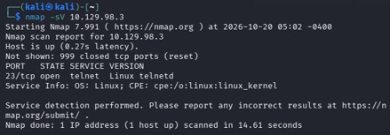
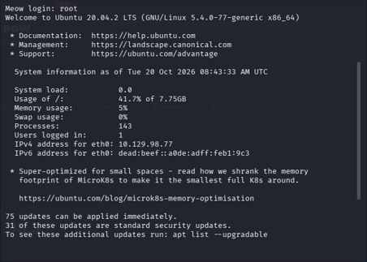
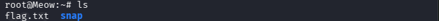
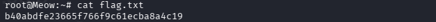

# Meow

**Difficulty:** Very Easy

## 1. Setup

To connect to the target machine, I used OpenVPN with the configuration file provided by Hack The Box (HTB). Alternatively, you can use Pwnbox to access the lab environment without setting up a VPN on your own computer.


After downloading the Starting Point VPN configuration file, I opened the terminal and ran the following command to connect to the VPN.

```bash
sudo openvpn <path-to-file>
```



To get the target's IP address, I pressed the **Start Machine** button on the HTB website.


After waiting for a while, the target machine's IP address appeared on the page.


After connecting to the VPN, I used the `ping` command with the target's IP address to check whether the machine was reachable.

```bash
ping <TARGET_IP>
```



If the target responds to the ping requests, it indicates that the machine is reachable over the network. You can stop the command by pressing `Ctrl + C`. However, some machines block ping requests, so no response does not always mean the machine is offline.

Now that the connection was set up, I was ready to start investigating the target machine.

## 2. Tools Used

- **Nmap:** Used to scan the target machine for open ports and identify running services.
- **Telnet:** Used to connect to the Telnet service discovered during enumeration.

## 3. Commands Used

| Command | Purpose |
|---|---|
| `ping <TARGET_IP>` | Check whether the target responds to network requests. |
| `nmap -sV <TARGET_IP>` | Scan for open ports and identify running services and their versions where possible. |
| `telnet <TARGET_IP> ` | Connect to the Telnet service on port 23. |
| `ls` | List files and directories in the current directory. |
| `cat flag.txt` | Display the contents of the flag file. |

## 4. Enumeration

### 4.1 Scanning the Target

After confirming that the target was reachable, I used Nmap to check which services were running on the machine.

```bash
nmap -sV <TARGET_IP>
```



From the scan results, I found that the target had an open Telnet service on port 23. Telnet allows users to access a remote machine through a text-based terminal.

Since the service was accessible, I decided to investigate whether I could connect to it.

### 4.2 Connecting Through Telnet

I used Telnet to connect to the target machine.

```bash
telnet <TARGET_IP> 
```


After connecting, the service asked me to log in. Sometimes, due to configuration mistakes, accounts may be left with blank passwords, making it easier for unauthorized users to access the system.

I decided to test whether I could log in without providing a password.

### 4.3 Testing Authentication

I tried using `root` as the username and leaving the password blank to see whether the machine allowed access without a password.



The login was successful, and I was able to access the machine as the root user.

This revealed a serious authentication weakness. Since the root account has extensive privileges, allowing access without a password could give an unauthorized user significant control over the machine.

### 4.4 Finding the Flag

After gaining access, I used the `ls` command to list the files in the current directory and check whether I could find what I was looking for.

```bash
ls
```



The listing showed a file named `flag.txt`. This was the file I needed to read to complete the challenge, so I used the `cat` command to display its contents.

```bash
cat flag.txt
```



The file contained the flag needed to complete the challenge. Keep in mind that filenames may differ between challenges, so check the directory listing instead of assuming the file will always be named `flag.txt`.

## 5. Findings

This challenge demonstrated how an exposed remote-access service combined with weak authentication can allow unauthorized access to a machine and its files.

The main steps were:

1. Checked whether the target machine was reachable.
2. Used Nmap to identify the open Telnet service.
3. Connected to Telnet and tested whether the root account could be accessed with a blank password.
4. Gained access to the machine and located the flag file.

## 6. Lessons Learned

- **Network connectivity:** Learned how to use `ping` to check whether a target machine is reachable.
- **Service enumeration:** Learned how Nmap can identify open ports and running services.
- **Authentication security:** Learned why accounts should never be left with blank passwords, especially accounts with high privileges.
- **Linux commands:** Practiced using `ls` to list files and `cat` to read file contents.

In a real environment, Telnet should generally be replaced with a more secure alternative, such as SSH, and all accounts should use appropriate authentication controls.
